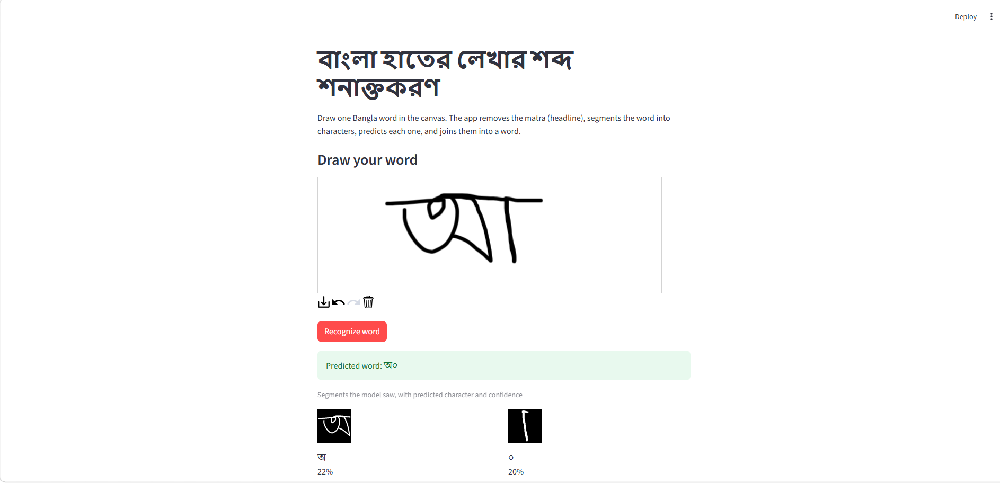
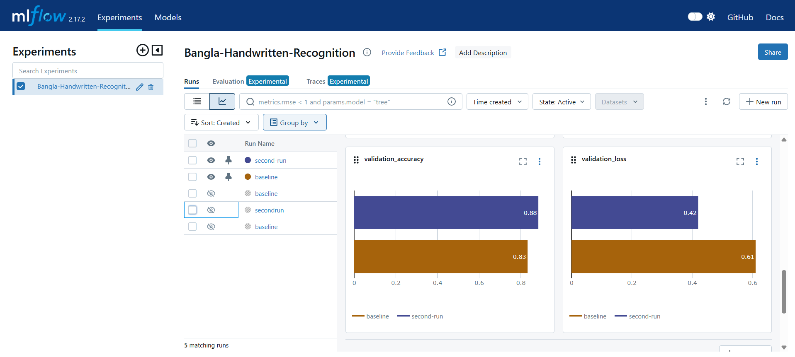

# Bangla Handwritten Word Recognition

**Name:** Anika Tabassum Omi
**Student ID:** 1000129232

A web application where the user draws one Bangla word and the page shows the predicted **whole word**
(for example, a drawing of মানুষ is shown as মানুষ and a drawing of জল is shown as জল).
It uses the BanglaLekha-Isolated dataset, a TensorFlow/Keras CNN, MLflow experiment tracking
a Streamlit interface and Docker.

## 1. Project structure

```
bangla-ocr-assignment/
|-- train.py                 trains the model and logs the experiment to MLflow
|-- app.py                   Streamlit app: draw a word, see the predicted word
|-- requirements.txt         Python dependencies
|-- Dockerfile               builds and runs the app in a container
|-- README.md                this file
|-- github_link.txt          public repository link
|-- labels.json              class index -> Bangla character
|-- models/
|   `-- best_model.keras          trained model used by the app and Docker
|-- artifacts/
|   `-- mlflow/              MLflow tracking data (runs, metrics, parameters)
`-- screenshots/
    |-- streamlit_app.png    app showing a predicted Bangla word
    `-- mlflow_experiment.png MLflow experiment page with the training runs
```

Not part of the submission (excluded by `.gitignore`, `.dockerignore` and the source zip):
`data/` (dataset), `.venv/`, `__pycache__/`, cache files and generated MLflow run data.

## 2. Dataset

BanglaLekha-Isolated from Mendeley Data:
https://data.mendeley.com/datasets/hf6sf8zrkc/2

- About 166,000 images of **single** handwritten Bangla characters.
- 84 classes: basic characters, numerals and selected compound characters.
- It contains no handwritten words, so word recognition has to be built from character recognition
  (see the approach below).

Download the dataset, extract it, and place it here:

```
data/
`-- BanglaLekha-Isolated/
    |-- Images/               <- the numbered class folders are inside
    |-- Form-based Marking...
    `-- Readme.txt
```

The dataset is large and must not be uploaded to GitHub or included in the zip.

## 3. Approach

The system has two stages.

1. **Character classifier.** Images are converted to grayscale, cropped to the ink, resized to a fixed
   square size, padded and normalised. A convolutional neural network (convolution + pooling blocks,
   a dense layer, dropout and a softmax output over 84 classes) is trained on the data. The data is
   split into training, validation and test sets. [Edit: image size, number of conv blocks, split ratio.]
2. **Word prediction.** The drawn word is split into separate characters, each character is classified
   by the CNN, and the predicted characters are joined in order into one string. The page displays
   this joined result as the predicted word. [Edit: describe how your app.py segments and joins the
   characters, including any handling of vowel signs and matra.]

`labels.json` maps each class index to its Bangla character.

**MLflow tracking.** Every run of `train.py` records the hyper-parameters (epochs, batch size,
learning rate, dropout and others), per-epoch training and validation loss and accuracy, final test
accuracy, and the trained model. All data is stored locally in `artifacts/mlflow`.
At least two runs with different settings were made and compared.

## 4. Results

| Run            | Validation accuracy | Test accuracy |
|--------------- |---------------------|---------------|
| baseline       | 83%                 | 84%           |
| second-run     | 88%                 | 89%           |

The best model is saved as `models/best_model.keras`.

## 5. How to run

Requires Python 3.11 (use the version you tested with) and, for step 8, Docker Desktop.

### 5.1 Create the environment and install packages
```bash
python -m venv .venv
.venv\Scripts\activate            # Windows
source .venv/bin/activate         # macOS / Linux
pip install -r requirements.txt
```

### 5.2 Prepare the dataset
Download and extract BanglaLekha-Isolated into `data/BanglaLekha-Isolated` (see section 2).

### 5.3 Train the model
```bash
python train.py
```
Run it at least twice with different settings, for example by changing the epochs, learning rate or
dropout (use the options in `train.py` or edit its settings). After training, these are created:
- `models/model.keras`: the trained model
- `artifacts/mlflow/`: the recorded MLflow experiment runs

### 5.4 View the experiments in MLflow
```bash
mlflow ui --backend-store-uri artifacts/mlflow --host 0.0.0.0 --port 5000
```
Open http://localhost:5000, select the experiment, and compare the runs.
The screenshot is in `screenshots/mlflow_experiment.png`.

### 5.5 Run the Streamlit app locally
```bash
streamlit run app.py
```
Open http://localhost:8501, draw a Bangla word on the canvas, and the predicted word appears below it.
The screenshot is in `screenshots/streamlit_app.png`.

### 5.6 Run with Docker
Make sure `models/model.keras` exists (train first), and that Docker Desktop is running.
```bash
docker build -t bangla-ocr-app:0.1 .
docker run -p 8501:8501 bangla-ocr-app:0.1
```
Open http://localhost:8501. Stop the container with Ctrl+C.

## 6. Screenshots




## 7. Limitations

- The dataset contains only isolated characters, not words, so word recognition depends on correctly
  separating the drawn word into characters. 
- Joined (cursive) handwriting, touching characters and a continuous matra can be segmented wrongly.
- Dependent vowel signs and complex compound characters may be misrecognised because the dataset
  has no separate classes for them.
- Accuracy on real handwritten words has not been measured on a large word dataset; the reported
  accuracy is for isolated characters.
- The model is small and trained on CPU without an extensive hyper-parameter search.
- The train/validation/test split is random at image level, not by writer, so the reported accuracy
  may be optimistic for unseen writers.

## 8. Repository

Public repository: see `github_link.txt`.